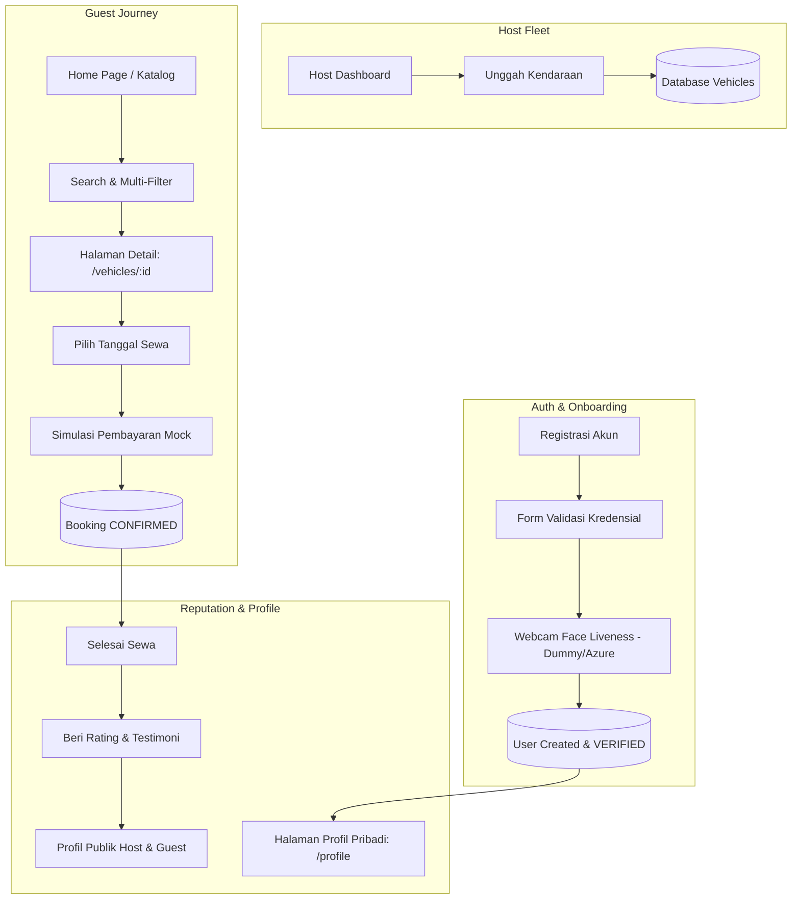

# Kelompokduasatu

## Anggota dan NIM

- Rakan Hendian Ramadhan — 24/540158/TK/59909
- Stella Florencia Doulim — 24/542739/TK/60285
- Rian Prasetya Munaji — 24/545573/TK/60702

## Project Senior Project TI

## Instansi

Departemen Teknologi Elektro dan Teknologi Informasi,  
Fakultas Teknik,  
Universitas Gadjah Mada

---

# Jawaban Modul 1

## 1. Nama Produk

**Rentify: Smart P2P Vehicle Sharing**

## 2. Jenis Produk

Rentify merupakan platform penyewaan kendaraan berbasis **peer-to-peer (P2P)** yang berperan sebagai perantara antara pemilik kendaraan (*host*) dan penyewa (*guest*).

## 3. Latar Belakang & Permasalahan

### Latar Belakang

Banyak kendaraan yang tidak dipakai selama berbulan-bulan, bisa jadi karena pemiliknya sedang pergi, sibuk, atau karena alasan lainnya. Alih-alih kendaraan tersebut tidak digunakan dan bahkan terkadang tidak dipelihara, kendaraan tersebut dapat digunakan oleh orang lain dalam bentuk sewa menyewa yang dapat menguntungkan kedua pihak.

Namun, implementasi penyewaan kendaraan dengan model peer-to-peer menghadirkan beberapa risiko keamanan serta krisis kepercayaan, sehingga diperlukan platform yang bertindak sebagai middleman dalam praktik sewa-menyewa.

### Rumusan Permasalahan

1. Bagaimana cara mengimplementasi sistem authentication bagi penyewa dan yang menyewakan, yang efisien dan aman, serta dapat meminimalisir risiko pemalsuan?
2. Bagaimana cara menjalin kepercayaan antara penyewa dan yang menyewakan?
3. Bagaimana cara membangun sistem penyewaan yang dinamis dan elastis yang dapat menghandle data dalam jumlah besar, serta menjamin ketersediaan layanan ketika trafik tinggi?

## 4. Ide Solusi

Rentify hadir sebagai platform penyewaan kendaraan berbasis peer-to-peer yang berperan sebagai perantara terpercaya antara pemilik kendaraan (*host*) dan penyewa (*guest*).

Untuk menjamin keamanan transaksi, Rentify dilengkapi verifikasi identitas otomatis melalui **e-KYC** dan **face liveness detection** guna memastikan setiap pengguna adalah pihak yang sah, serta fitur **deteksi kerusakan kendaraan berbasis analisis foto** untuk menjaga transparansi dan integritas setiap transaksi sewa.

Sistem **rating** dan **pelacakan lokasi (GPS)** turut disertakan untuk memperkuat rasa saling percaya antar pengguna. Keseluruhan platform dibangun di atas **arsitektur cloud yang elastis**, sehingga mampu beradaptasi terhadap lonjakan trafik maupun pertumbuhan jumlah pengguna secara dinamis.

### Rancangan Fitur Solusi

| Fitur | Keterangan & Cakupan Milestone |
|---|---|
| **Verifikasi Face Liveness (Registrasi)** | Verifikasi keaslian wajah via webcam pada saat registrasi akun baru (Sign Up). Menggunakan dummy placeholder (selalu valid) yang siap digantikan dengan Azure Face Liveness API. *(Milestone 1)* |
| **Listing Kendaraan oleh Host** | Host dapat mendaftarkan armadanya ke database lengkap dengan foto, deskripsi, tarif harian, kategori, kapasitas, transmisi, dan kota/lokasi. *(Milestone 1)* |
| **Display Katalog & Detail Kendaraan** | Tampilan seluruh armada aktif di Home Page dengan halaman detail dinamis ber-URL unik (`/vehicles/[id]`) untuk tiap kendaraan. *(Milestone 1)* |
| **Instant Booking & Payment** | Pemesanan instan dengan pemilihan rentang tanggal sewa, kalkulasi tarif otomatis, dan simulasi pembayaran dummy (langsung terkonfirmasi). *(Milestone 1)* |
| **Pencarian & Multi-Parameter Filter** | Pencarian teks berbasis merk/model/kota digabung filter kategori, transmisi (Matic/Manual), rentang harga, dan ketersediaan. *(Milestone 1)* |
| **Profil Pribadi, Publik & Rating** | Profil pribadi (`/profile`) untuk kelola akun/riwayat sewa; profil publik (`/users/[id]`) untuk reputasi host/guest; serta ulasan & rating bintang pasca-sewa. *(Milestone 1)* |
| **e-KYC & Verifikasi Dokumen Lanjutan** | Validasi otomatis KTP, SIM, dan pencocokan biometrik penyewa untuk mencegah penipuan/pencurian kendaraan. *(Milestone Lanjutan)* |
| **Deteksi Kerusakan Kendaraan** | Analisis foto kondisi fisik kendaraan sebelum (check-in) dan sesudah (check-out) masa sewa untuk mendeteksi baret/penyok secara otomatis. *(Milestone Lanjutan)* |
| **Chatbot Asisten Sewa** | Rekomendasi kendaraan dan bantuan syarat sewa interaktif berbasis AI. *(Milestone Lanjutan)* |
| **Pelacakan GPS** | Aplikasi dapat melakukan pelacakan lokasi real-time terhadap kendaraan yang disewakan. *(Milestone Lanjutan)* |

---

# 5. Analisis Kompetitor

## Kompetitor 1 — TREVO

**Jenis Kompetitor:** Direct Competitor

**Jenis Produk:** Aplikasi P2P Car Sharing / Rental Mobil Pribadi

**Target Customer:** Pemilik mobil pribadi yang ingin monetisasi aset (*host*) dan penyewa mobil harian/liburan (*guest*).

### Kelebihan

- Pelopor konsep P2P car rental di pasar Indonesia.
- Dilengkapi asuransi rekanan dan pelacakan GPS terintegrasi.
- Pilihan mobil beragam langsung dari pemilik individu.

### Kekurangan

- Proses persetujuan dokumen manual terkadang memakan waktu lama.
- Ketersediaan armada masih terkonsentrasi di kota-kota besar (Jabodetabek, Bandung, Bali).
- Tarif dan respons pemilik kendaraan terkadang tidak konsisten.

### Key Competitive Advantage & Unique Value

Platform spesifik P2P dengan proteksi asuransi khusus dan fleksibilitas durasi sewa harian hingga bulanan.

---

## Kompetitor 2 — Traveloka (Layanan Rental Mobil)

**Jenis Kompetitor:** Indirect Competitor

**Jenis Produk:** Aggregator Rental Kendaraan B2C (Kemitraan dengan Rental Resmi)

**Target Customer:** Wisatawan domestik/mancanegara dan pelancong bisnis.

### Kelebihan

- Basis pengguna raksasa dan ekosistem pemesanan terpadu (tiket, hotel, rental).
- Standar armada terjamin karena bermitra dengan vendor rental komersial terdaftar.
- Dukungan layanan pelanggan 24/7 dan berbagai metode pembayaran.

### Kekurangan

- Biaya sewa cenderung lebih tinggi (ada margin vendor dan platform).
- Tidak membuka kesempatan bagi individu untuk menyewakan kendaraan pribadinya.
- Pilihan kendaraan terbatas pada tipe-tipe komersial populer.

### Key Competitive Advantage & Unique Value

Kepercayaan konsumen yang tinggi, ekosistem all-in-one travel, dan kepastian unit dari vendor rental resmi.

---

## Kompetitor 3 — Gojek (Layanan GoCar & GoCar Transporter)

**Jenis Kompetitor:** Tertiary Competitor

**Jenis Produk:** Layanan Transportasi On-Demand & Sewa Mobil dengan Pengemudi (Ride-hailing)

**Target Customer:** Komuter perkotaan yang membutuhkan mobilitas titik-ke-titik instan tanpa harus mengemudi sendiri.

### Kelebihan

- Penjemputan instan dalam hitungan menit tanpa proses administrasi sewa.
- Pengguna tidak menanggung risiko kerusakan atau perawatan kendaraan.
- Jangkauan operasional sangat luas hingga ke pelosok kota.

### Kekurangan

- Tidak menyediakan opsi lepas kunci (mengemudi sendiri).
- Biaya menjadi sangat mahal jika digunakan untuk perjalanan jarak jauh seharian penuh atau lintas kota.
- Kurang cocok untuk kebutuhan perjalanan keluarga multi-hari yang membutuhkan fleksibilitas barang bawaan.

### Key Competitive Advantage & Unique Value

Kecepatan akses (on-demand), ketersediaan pengemudi instan, dan integrasi pembayaran dompet digital (GoPay).

---

# 6. Spesifikasi & Detail Implementasi Fitur (Milestone Saat Ini)

Bagian ini memuat rincian alur teknis, skema data, antarmuka, dan endpoint API untuk 6 fitur utama yang diprioritaskan pada tahap implementasi saat ini berdasarkan `docs/features.md`.

---

## Fitur 1: Verifikasi Face Liveness pada Registrasi Akun

Fitur ini menjamin bahwa setiap akun yang dibuat merupakan individu asli (bukan bot atau identitas palsu) melalui pemindaian wajah langsung via webcam saat proses pendaftaran akun baru.

### 1. Alur Kerja (Workflow)
1. **Input Kredensial:** Calon pengguna mengakses halaman pendaftaran (`/register`), mengisi form registrasi (nama, email, password, peran Host/Guest, dan nomor telepon opsional).
2. **Validasi Kredensial:** Sistem memvalidasi input di sisi klien dan server. Jika kredensial valid dan email belum terdaftar, alur dilanjutkan ke tahap verifikasi wajah.
3. **Pemicu Webcam:** Antarmuka memunculkan komponen pemindai wajah (webcam stream) langsung di layar.
4. **Eksekusi Liveness (Dummy Placeholder):** Pengguna menekan tombol "Verifikasi Wajah". Sistem mengeksekusi fungsi dummy liveness yang mensimulasikan pemindaian biometrik dengan latensi singkat (mock delay ~1 detik) dan mengembalikan status **VALID**.
5. **Penyimpanan Akun:** Setelah verifikasi berhasil, akun pengguna disimpan ke database dengan kolom `verificationStatus: VERIFIED`. Pengguna diarahkan ke halaman login atau langsung dibuatkan sesi login aktif.
6. **Kesiapan Integrasi:** Arsitektur fungsi dibuat modular (`verifyFaceLiveness(streamData)`) sehingga pemanggilan dummy dapat langsung ditukar dengan integrasi SDK / API **Microsoft Azure Face Liveness API** tanpa mengubah alur antarmuka.

### 2. Skema Data & Endpoint
- **Model Terkait (`prisma/schema.prisma`):**
  - `User.verificationStatus`: Berubah dari `UNVERIFIED` menjadi `VERIFIED`.
- **Endpoint API:**
  - `POST /api/auth/register`: Menerima payload registrasi lengkap dengan konfirmasi liveness token/status.
  - `POST /api/auth/verify-liveness-dummy`: Endpoint / helper service untuk memvalidasi frame liveness sementara.

---

## Fitur 2: Pengunggahan Kendaraan oleh Host (Listing & Fleet Management)

Memungkinkan pengguna dengan peran `HOST` untuk mendaftarkan dan mempublikasikan unit kendaraannya ke dalam sistem sewa Rentify.

### 1. Alur Kerja (Workflow)
1. **Hak Akses:** Hanya pengguna dengan peran `HOST` yang telah login dan terverifikasi yang dapat mengakses form pengunggahan kendaraan.
2. **Pengisian Data Kendaraan:** Host mengisi formulir spesifikasi unit secara komprehensif:
   - **Merk & Model:** Contoh: `Toyota Avanza Veloz 2023`, `Honda PCX 160`.
   - **Kategori:** Pilihan `MOBIL` atau `MOTOR`.
   - **Harga Sewa per Hari:** Nilai nominal integer dalam IDR (misal: `350000`).
   - **Foto Kendaraan:** URL gambar atau berkas unggahan foto tampak kendaraan.
   - **Transmisi:** Pilihan `AUTOMATIC` atau `MANUAL`.
   - **Kapasitas Penumpang:** Jumlah kursi (misal: `7` penumpang).
   - **Lokasi / Kota:** Kota operasional ketersediaan kendaraan (misal: `Yogyakarta`, `Sleman`, `Bantul`).
   - **Deskripsi:** Informasi fasilitas, ketentuan lepas kunci, kondisi unit, dan aturan penggunaan.
3. **Penyimpanan:** Data divalidasi dengan `Zod` di backend, lalu disimpan ke tabel `vehicles` dengan status ketersediaan awal `AVAILABLE`.
4. **Manajemen Unit:** Unit yang telah diunggah langsung tampil di halaman inventaris Host dan otomatis tersedia di katalog publik.

### 2. Skema Data & Endpoint
- **Model Terkait (`Vehicle`):**
  - Perluasan atribut: `kategori`, `transmisi`, `kapasitas`, `lokasi`, `foto_url`, `deskripsi`.
- **Endpoint API:**
  - `POST /api/vehicles`: Menyimpan kendaraan baru (dilindungi middleware `requireRole('HOST')`).
  - `GET /api/vehicles/my-fleet`: Mengambil seluruh kendaraan milik Host yang sedang login.

---

## Fitur 3: Display Katalog di Home Page & Dynamic Detail Page

Katalog publik sebagai etalase utama yang dapat diakses oleh semua calon penyewa untuk melihat dan mengeksplorasi armada yang tersedia.

### 1. Alur Kerja & Antarmuka
1. **Home Page (`/` / `/home`):**
   - Menampilkan *hero section*, ringkasan pencarian cepat, dan *grid view* kartu kendaraan.
   - Setiap kartu menampilkan: Foto utama, merk & model, kategori, kota/lokasi, jenis transmisi, kapasitas penumpang, rating rata-rata bintang, dan tarif sewa per hari.
   - Menampilkan status ketersediaan (`AVAILABLE`).
2. **Dynamic Detail Page (`/vehicles/[id]`):**
   - Tiap kartu dapat diklik dan mengarahkan pengguna ke halaman rute dinamis dengan URL unik berdasarkan ID kendaraan (misal: `/vehicles/12`).
   - Halaman detail memuat:
     - Galeri foto kendaraan beresolusi tinggi.
     - Rincian spesifikasi teknis lengkap.
     - Profil singkat Host pemilik (nama, foto, badge verifikasi, rating host, link ke profil publik host).
     - Daftar ulasan dan komentar dari penyewa terdahulu.
     - Widget interaktif kalkulator sewa & pemesanan (booking form).

### 2. Endpoint API
- `GET /api/vehicles`: Mengambil daftar kendaraan aktif untuk tampilan katalog.
- `GET /api/vehicles/:id`: Mengambil detail lengkap 1 kendaraan beserta relasi data Host dan Review.

---

## Fitur 4: Alur Penyewaan (Instant Booking) & Simulasi Pembayaran

Memfasilitasi transaksi penyewaan langsung oleh Guest dengan proses reservasi dan pembayaran yang instan dan transparan.

### 1. Alur Kerja (Workflow)
1. **Pemilihan Durasi:** Pada halaman `/vehicles/[id]`, Guest memilih tanggal mulai sewa (`tanggal_mulai`) dan tanggal selesai sewa (`tanggal_selesai`).
2. **Kalkulasi Otomatis:** Sistem menghitung durasi hari sewa dan mengalikan dengan `harga_per_hari` untuk menampilkan rincian total tagihan.
3. **Konfirmasi & Checkout:** Guest mengklik "Sewa Sekarang". Sistem memeriksa ketersediaan tanggal agar tidak terjadi bentrok pemesanan (*no double-booking*).
4. **Simulasi Pembayaran (Mock Payment):**
   - Menampilkan antarmuka ringkasan pembayaran dummy (pilihan metode: Transfer Bank Virtual Account / Dompet Digital).
   - Pengguna menekan tombol "Bayar Sekarang (Simulasi)".
   - Backend memproses transaksi instan: data `Payment` dibuat dengan status `PAID` / `SETTLED`.
5. **Konfirmasi Booking:** Status `Booking` otomatis berubah menjadi `CONFIRMED`. Notifikasi atau instruksi serah terima unit ditampilkan ke pengguna dan tercatat di riwayat sewa.

### 2. Skema Data & Endpoint
- **Model Terkait:**
  - `Booking`: `guest_id`, `vehicle_id`, `tanggal_mulai`, `tanggal_selesai`, `status_booking` (`PENDING`, `CONFIRMED`, `COMPLETED`, `CANCELLED`).
  - `Payment`: `booking_id`, `jumlah_bayar`, `status_pembayaran` (`PAID`, `FAILED`).
- **Endpoint API:**
  - `POST /api/bookings`: Membuat reservasi sewa (dilindungi middleware `requireAuth()`).
  - `POST /api/payments/simulate`: Menjalankan simulasi pembayaran instan untuk booking terkait.

---

## Fitur 5: Sistem Pencarian (Search) & Multi-Parameter Filter

Mempermudah penyewa menemukan armada yang paling sesuai dengan kebutuhan perjalanan, anggaran, maupun preferensi teknis.

### 1. Parameter & Kriteria Pencarian
Katalog kendaraan di halaman utama dilengkapi filter reaktif:
- **Pencarian Teks Bebas (`search`):** Pencocokan substring (case-insensitive) pada merk, model kendaraan, dan nama kota/wilayah.
- **Filter Kategori (`kategori`):** Pilihan multi-select / switch antara `Mobil` dan `Motor`.
- **Filter Transmisi (`transmisi`):** Opsi `Automatic` (Matic) atau `Manual`.
- **Filter Rentang Harga (`minPrice` & `maxPrice`):** Slider atau input nominal batas harga terendah dan tertinggi per hari.
- **Filter Ketersediaan (`availableOnly`):** Default aktif untuk hanya memunculkan unit dengan status siap sewa.

### 2. Mekanisme Teknis
- Pengaturan filter disinkronkan ke URL query params (misal: `/home?search=avanza&city=yogyakarta&transmisi=AUTOMATIC&maxPrice=500000`) agar ramah bookmark dan dapat dibagikan (*shareable link*).
- Backend menggunakan klausa query Prisma yang dinamis (`where: { AND: [...] }`) dengan pencarian teks `mode: 'insensitive'`.

### 3. Endpoint API
- `GET /api/vehicles?search=...&kategori=...&transmisi=...&minPrice=...&maxPrice=...&city=...`

---

## Fitur 6: Halaman Profil Pribadi, Profil Publik & Sistem Review/Rating

Membangun reputasi dan rasa saling percaya (*trust system*) antar komunitas pengguna platform P2P Rentify.

### 1. Struktur Halaman Profil
- **Halaman Profil Pribadi (`/profile`):**
  - Hanya dapat diakses oleh pemilik akun yang bersangkutan (terotentikasi).
  - Menampilkan ringkasan akun (nama, email, nomor telepon, peran, badge `VERIFIED`).
  - **Tab Riwayat Sewa (Guest):** Daftar pemesanan yang sedang berjalan, selesai, maupun dibatalkan, lengkap dengan tombol untuk memberikan ulasan pada sewa yang telah selesai.
  - **Tab Armada Saya (Host):** Daftar kendaraan yang didaftarkan oleh Host, status operasional tiap unit, dan riwayat pesanan masuk dari para penyewa.
- **Halaman Profil Publik (`/users/[id]`):**
  - Dapat diakses oleh siapa pun (baik Host maupun Guest lain).
  - Menampilkan nama, foto profil, peran, tanggal bergabung, dan badge verifikasi.
  - Ringkasan skor reputasi: Skor rating bintang rata-rata (1.0 – 5.0) dan jumlah total ulasan.
  - Ulasan & testimoni yang diterima dari pengguna lain beserta tanggal ulasan.
  - Jika profil milik Host: Menampilkan daftar etalase kendaraan aktif yang disewakan oleh Host tersebut.

### 2. Mekanisme Rating & Review
1. **Syarat Ulasan:** Review hanya dapat dibuat oleh Guest terhadap transaksi booking yang telah berstatus `COMPLETED` (masa sewa telah berakhir).
2. **Konten Ulasan:**
   - Skor rating integer (skala 1 sampai 5 bintang).
   - Testimoni tertulis mengenai kondisi kendaraan dan pengalaman bertransaksi.
3. **Agregasi:** Sistem menghitung skor rating rata-rata kendaraan dan Host secara dinamis dari tabel `Review`.

### 3. Endpoint API
- `GET /api/users/profile`: Mengambil data profil pribadi user yang sedang login beserta riwayat sewa/armadanya.
- `GET /api/users/:id/public`: Mengambil profil publik pengguna beserta statistik rating dan ulasan yang diterima.
- `POST /api/reviews`: Menambahkan ulasan dan rating baru untuk booking yang telah selesai.
